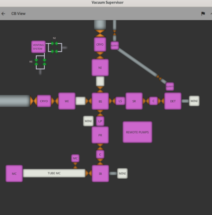
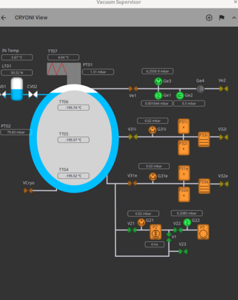
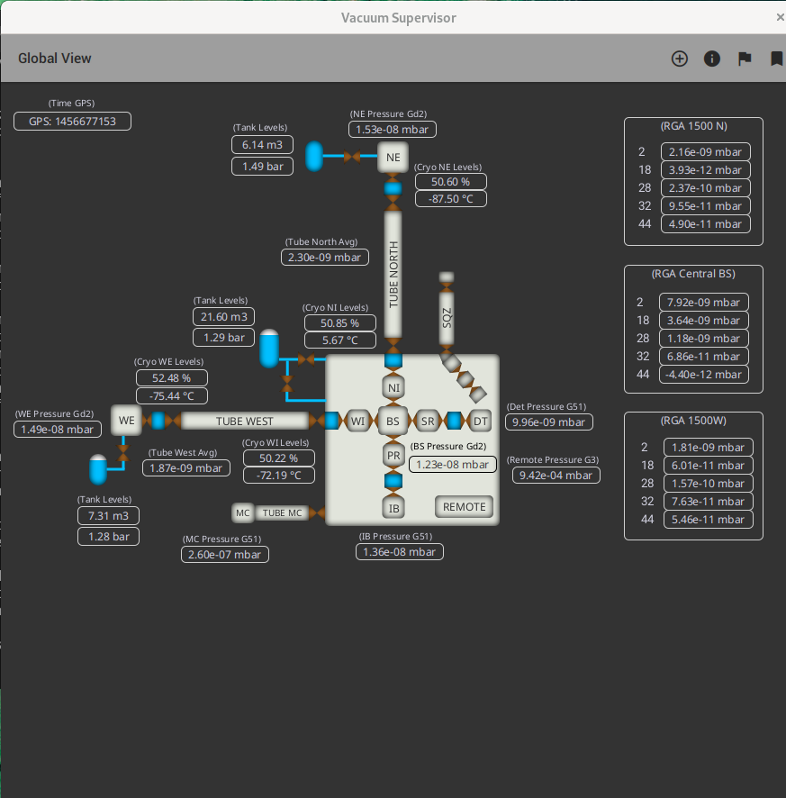
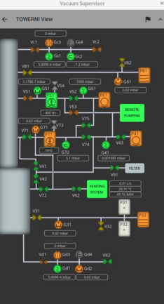

# VACUUM Supervisor Client

VACUUM Supervisor is a Java client application used by operators to monitor and control distributed vacuum subsystems (tube sectors, towers, cryogenic links, remote pumps, gauges, and supervisor actions).

## Project Scope

This repository contains the supervisor client app, including:

- UI views and layers for station/subsystem dashboards (`View*`, `Layer*`, `SidePopupView*`)
- UI graphics/layout authored with Gluon Scene Builder and FXML resources (`MainApp/src/main/resources/*.fxml`)
- interaction and control logic (`Controller*`)
- data models and mappings for telemetry, flags, and commands (`DataSet*`, `DataElement`, `DataTypes`, `ControlCommand`)
- packaging/build configuration for desktop and mobile deployment

Out of scope for this repository:

- backend services and control-system servers
- site-specific online data infrastructure

## Technology

- Gluon platform and libraries (Charm / Glisten / Charm Down):  
  https://gluonhq.com/  
  https://gluonhq.com/products/mobile/
- JavaFXPorts mobile Gradle plugin (`org.javafxports:jfxmobile-plugin`):  
  https://github.com/javafxports/javafxmobile-plugin

## Build Examples

```bash
./gradlew :MainApp:run
./gradlew :MainApp:android
```

## GitHub Release Workflow

Pushing a version tag builds the Android APK, Windows installer, and Linux tarball, then attaches them to the matching GitHub Release:

```bash
git tag v0.2.3
git push origin v0.2.3
```

The workflow uses the tag without the leading `v` as the release version. Android release signing requires these repository secrets:

- `ANDROID_RELEASE_KEYSTORE_BASE64` - base64-encoded Android signing keystore
- `RELEASE_STORE_PASSWORD`
- `RELEASE_KEY_ALIAS`
- `RELEASE_KEY_PASSWORD`

## Windows Installer

Preferred release path on Windows:

```powershell
powershell -ExecutionPolicy Bypass -File .\scripts\build_windows_setup.ps1 -JavaHome C:\path\to\jdk
```

If Inno Setup 6 is installed, this produces `build\windows-installer\output\VacuumSupervisorSetup-<version>.exe`.

The Linux helper `./scripts/build_windows_setup.sh` is an NSIS-based cross-build path. It requires an external Windows JavaFX JDK zip via `--jdk-zip` and a working local NSIS toolchain. Do not treat the checked-in `Windows_Install\VacuumSupervisorSetup-*.exe` as the authoritative release artifact; rebuild locally before shipping.


## Local Backend Override

For local testing against an internal backend host without changing the public-safe default:

```bash
VACUUM_SUPERVISOR_BACKEND_HOST=<internal-backend-host> ./gradlew :MainApp:run
```

The desktop client also accepts the JVM property `vacuum.supervisor.backend.host` when launched outside Gradle.
You can provide either a bare host such as `olserver135.virgo.infn.it` or a full URL; the client will extract the host and rebuild the service-specific endpoint paths.

To verify that no internal hostnames were accidentally committed:

```bash
./scripts/check_no_internal_hosts.sh
```

## Access From Outside Virgo (Firewall Login)

The backend is inside the Virgo network. From outside, the firewall portal (a Check Point captive portal) must be
passed first; the client does it itself, with the login and password entered in the application.

- The **key** icon of the Global view, or the **FIREWALL LOGIN** button under the "Network is unreachable" /
  "No response from server" messages, opens the login dialog: login, password and "Log in automatically". Each user enters
  their own login; it is saved locally with the client.
- **LOG IN** saves the settings and logs in at once; **SAVE** only saves them.
- With "Log in automatically" and a saved login, the client logs in by itself at startup, and again each time the
  backend is not reached (when the portal session expires), then the views get their data again at their next cycle.
- If the portal refuses the login, no further automatic attempt is made until the login is saved again, so that a
  wrong password cannot lock the account.

`PortalLogin.java` follows the portal page's own sequence (session, public key and one-time token, encrypted
password, final state), the same as in the raven-kn logbook client; a firewall update may change it, and the client
then says so instead of guessing.

- The portal address and the name on its certificate are built in (`PortalAccess.java`); "Show the portal address"
  in the dialog allows another one.
- The password is sent only to the portal address, over HTTPS with the certificate verified. The firewall node
  presents a certificate issued for another name than its address; "name on the portal certificate" makes the check
  use that name. Verification is never switched off.
- The certificate authority of the portal (HARICA 2021 roots, public) is missing from the Java 8 and older Android
  lists; it is added from `MainApp/src/main/resources/portal-roots.pem` to the platform's own list, for the portal
  connection only.
- The login and its password are stored in the application's private storage, not encrypted
  (`vacuum_supervisor_portal.properties`, owner-only file).

## Client Illustrations

### CB


### CRYO


### Global


### TOWER

